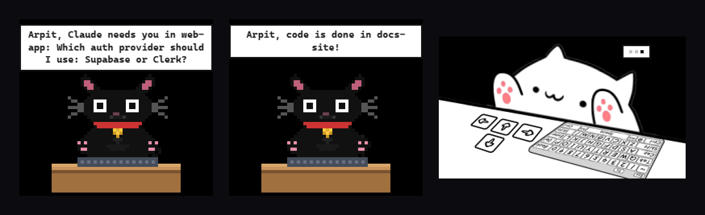
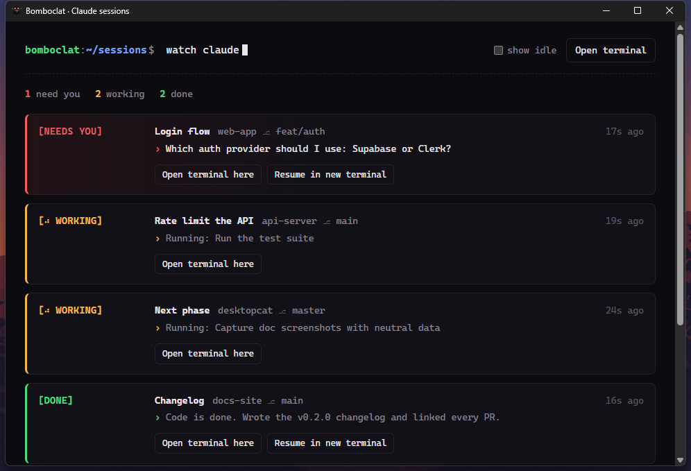
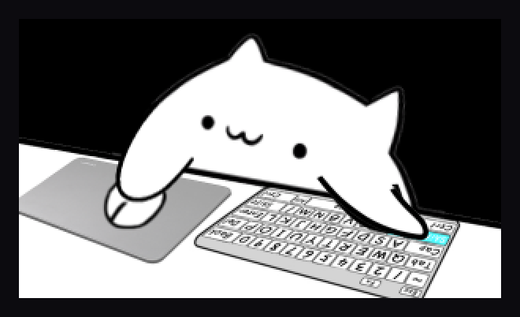
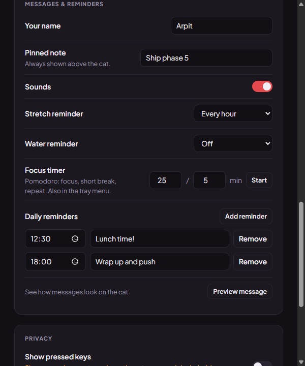
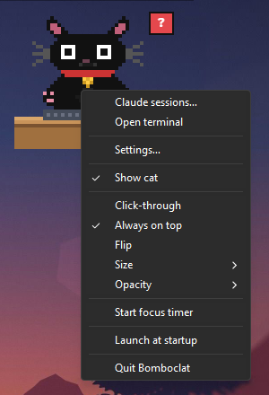
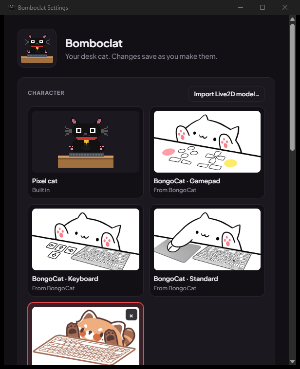

<div align="center">

# 🐈‍⬛ Bomboclat

**A desk cat that types along with you, wears BongoCat's Live2D models, and taps you on the shoulder when Claude Code needs you.**

Windows · Tauri 2 · Rust + vanilla JS · ~4 MB · no telemetry

[](https://github.com/Arpit-oo/bomboclat/actions/workflows/ci.yml)



</div>

---

## Why

You run three Claude Code sessions in three terminals. One finished ten minutes ago, one is
stuck on *"Allow Bash?"*, and one is still grinding. You find out by alt-tabbing through all
of them.

Bomboclat sits on your desktop and **just tells you**: a `...` while agents work, a red `?`
when one needs you (with the question it's asking), and *"code is done in web-app!"* when a
turn ends. It also happens to be a very good bongo cat.

## Highlights

| | |
|---|---|
| ⌨️ **Bongo paws** | Every key and click slams a paw on the desk. Eyes follow your cursor. Blinks, naps when you're idle. |
| 🎭 **Live2D models** | Runs BongoCat's Standard / Keyboard / Gamepad models straight from your BongoCat install, plus any Cubism 3/4 model you import. Pressed keys light up on the model's keyboard. |
| 🤖 **Claude sessions** | Every Claude Code (and Codex) session the cat can see: **working** (and on what), **needs you** (and what it's asking), **done** (with a summary). One click opens a terminal in that project or resumes the session. |
| 💬 **Speech bubbles** | Pixel-style bubbles for agents, reminders, a pinned note, and a pomodoro countdown. |
| 💧 **Reminders** | Water every 30 min, stretch every hour, daily reminders at set times. They pause while you're away. |
| 🍅 **Focus timer** | Pomodoro loop from the menu, countdown right on the cat. |
| 🔒 **Local only** | Reads local log files. Sends nothing anywhere. No account, no telemetry. |

## Quick start

**Run from source** (needs [Node 20+](https://nodejs.org), [Rust](https://rustup.rs) and the WebView2 runtime, which Windows 11 has):

```bat
run.bat
```

First run installs dependencies and downloads Live2D Cubism Core, then the cat appears
top-right. **Right-click it** for everything else.

**Build an installer:** `build.bat` → `src-tauri\target\release\bundle\nsis\Bomboclat_<version>_x64-setup.exe`
(installs per user, no admin prompt).

---

## 🤖 Claude sessions



Right-click the cat → **Claude sessions…** (or `bomboclat --sessions`). Each session shows:

| State | What it means | Where it comes from |
|---|---|---|
| `[⠋ WORKING]` | Busy, with what it's doing: *Running: cargo test*, *Editing auth.rs*, *Thinking…* | Prompts, tool calls and tool results in the transcript |
| `[NEEDS YOU]` | Waiting on you, with the question: *Which auth provider should I use?* | `AskUserQuestion`, a plan waiting for approval, a turn that ends on a question, or a permission prompt (via the optional hook) |
| `[WAITING?]` | A tool call has been silent for 30 s. Probably a permission prompt. | Heuristic, shown when the hook isn't installed |
| `[DONE]` | **Code is done**, with the first line of its final message | `end_turn` / `turn_duration` |
| `[IDLE]` | Nothing for 10+ minutes | Timer |

Each card has **Open terminal here** (Windows Terminal, or a console window) and, for
sessions that aren't running, **Resume in new terminal** (`claude --resume <id>`). The title
is Claude's own session title, with the project folder and git branch next to it.

The cat says it out loud too:

- **needs you:** *"Arpit, Claude needs you in web-app: Which auth provider should I use?"* plus a red `?` by its head
- **done:** *"Arpit, code is done in docs-site!"* plus a happy hop (Live2D models play their own motion and sound)

### Precise permission alerts (optional)

Claude Code doesn't write permission prompts (*"Allow Bash?"*) to its transcript. It only
sends them to **Notification hooks**. Turn on **Settings → AI agents → Precise permission
alerts** and Bomboclat adds one hook to `~/.claude/settings.json`:

```json
{ "hooks": { "Notification": [ { "matcher": "", "hooks": [
  { "type": "command", "command": "\"C:/…/bomboclat.exe\" --hook-event" } ] } ] } }
```

`bomboclat.exe --hook-event` doesn't start the app. It appends the notification to
`%APPDATA%\com.arpit.bomboclat\claude-events.jsonl` and exits. Your original settings file is
backed up to `settings.json.bomboclat-backup` before the first change, other hooks are left
alone, and turning the switch off removes only Bomboclat's entry.

## 🎭 BongoCat & Live2D models



Two pixel characters are built in: the **Pixel cat** and the **Claude crab**, an orange crab
that bongos its claws on the keyboard. Pick either under **Settings → Character**.

If [BongoCat](https://github.com/ayangweb/BongoCat) is installed, its **Standard**, **Keyboard**
and **Gamepad** models appear under **Settings → Character**. They're read in place from
`%LOCALAPPDATA%\BongoCat`, never copied.

**Import any Live2D model** with *Import Live2D model…*. Pick the folder; nested downloads are
fine. Models in the BongoCat layout get the full treatment:

```
my-model/
├─ cat.model3.json          ← any *.model3.json works
├─ resources/background.png ← the desk, sets the window shape
├─ resources/cover.png      ← thumbnail
├─ resources/left-keys/KeyA.png, ShiftLeft.png, …   ← left paw
└─ resources/right-keys/UpArrow.png, …              ← right paw
```

A key slams the paw on the side its image lives in, and keys without an image don't react
(same rule as BongoCat). The mouse paw and head follow your cursor through `ParamMouseX/Y` and
`ParamAngleX/Y`.

<br clear="right" />

## 💬 Messages, reminders, focus



- **Water** every 30 min and **stretch** every hour by default, adjustable or off.
- Both **pause while you're away** (5 min with no input), so you don't come back to a pile of nags.
- **Daily reminders** at a set time (*"Lunch!"* at 12:30).
- **Focus timer**: 25/5 pomodoro, started from the menu, with the countdown on the cat.
- **Pinned note** that always sits above the cat.
- Your **name** in every message, and an optional chime.

<br clear="right" />

## 🕹️ Controls



| Do this | To |
|---|---|
| **Right-click the cat** | Open the menu: Claude sessions, Open terminal, Settings, size, opacity, flip, focus timer, quit |
| Drag the cat | Move it (position is remembered) |
| Left-click the tray icon | Show / hide |
| Right-click the tray icon | Same menu as the cat |
| `Ctrl` `Shift` `Alt` `C` | Show / hide from anywhere |
| `bomboclat --settings` | Open Settings (also works while it's running) |
| `bomboclat --sessions` | Open Claude sessions |

With **click-through** on, clicks pass straight through the cat. Use the tray icon to get the
menu back.

<br clear="right" />

## ⚙️ Settings



Character, size (50–200%), opacity, flip, always on top, click-through, fade on hover, sleep
timer, AI agents, messages and reminders, the pressed-key bubble (**off by default**: it would
show passwords on a screen share), and launch at startup.

Everything is saved instantly to `%APPDATA%\com.arpit.bomboclat\settings.json`.

<br clear="right" />

## 🔒 Privacy

Bomboclat reads, and never uploads:

| Reads | Why |
|---|---|
| Global key/mouse events (in memory only) | Paws, eyes, idle detection. Never stored. |
| `~/.claude/projects/**/*.jsonl`, `~/.codex/sessions/**` | Session status. Read-only. |
| `%LOCALAPPDATA%\BongoCat\resources\models` | BongoCat's models, read in place |

Writes: its own `settings.json`, imported models, and `claude-events.jsonl` (only if you turn
on precise alerts, which also adds the hook to `~/.claude/settings.json`).

---

## 🛠️ Develop

```sh
npm install
npm run setup:live2d   # downloads Live2D Cubism Core into public/ (proprietary, not committed)
npm run tauri dev
```

`src-tauri` has unit tests (`cargo test`) for transcript parsing, the hook editor, reminders
and more. CI runs the frontend build, `cargo clippy -D warnings` and `cargo test` on every PR.

See **[docs/ARCHITECTURE.md](docs/ARCHITECTURE.md)** for how it fits together.

### Release

```sh
npm run version:set -- 0.2.0        # package.json, tauri.conf.json, Cargo.toml
git commit -am "release: v0.2.0"
git tag v0.2.0 && git push && git push --tags
```

GitHub Actions builds the installer and opens a **draft release** with it attached. Review it
and publish.

## Roadmap

- [x] Pixel cat, eye tracking, global input hook
- [x] Claude crab pixel character
- [x] Desk, bongo paws, key bubble, sleep
- [x] Tray, settings, persistence, global shortcut, autostart
- [x] BongoCat-style Live2D models (BongoCat's own + imported)
- [x] Agent watcher, reminders, focus timer, speech bubbles
- [x] Installer, CI, tagged releases
- [x] Claude sessions window, needs-you detection, permission hook, open/resume terminal
- [ ] Code signing (no more SmartScreen warning) + auto-updater
- [ ] Gamepad input for the gamepad model
- [ ] Jump to the *existing* terminal tab of a session

## Credits & licenses

- Inspired by [BongoCat](https://github.com/ayangweb/BongoCat). Its models belong to their
  authors and are read from your own install, never redistributed.
- Live2D rendering via [pixi-live2d-display](https://github.com/guansss/pixi-live2d-display).
  **Live2D Cubism Core** is proprietary. It's downloaded at build time, and using it means accepting
  the [Live2D Proprietary Software License](https://www.live2d.com/eula/live2d-proprietary-software-license-agreement_en.html)
  (free for individuals and small businesses).
- Built with [Tauri](https://tauri.app) and [rdev](https://github.com/Narsil/rdev).
- Bomboclat's own code: license **TBD** (add one before making the repo public).
